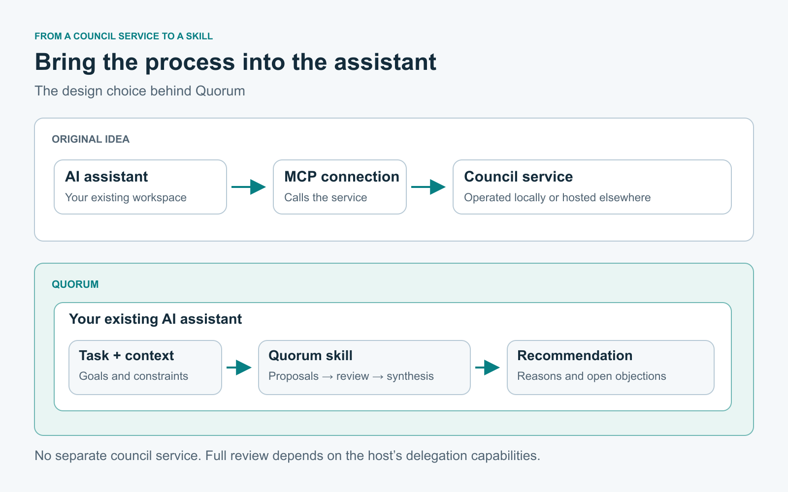
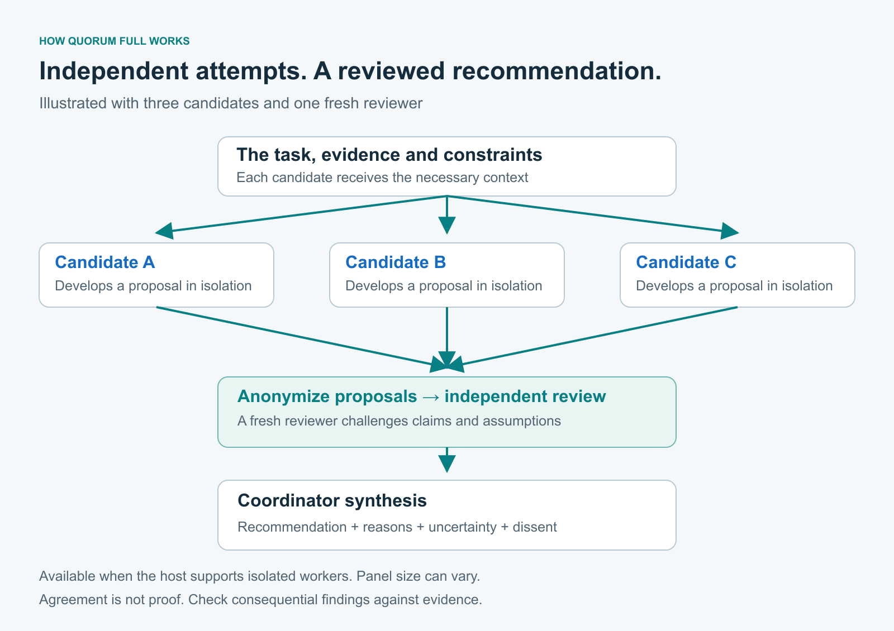

# Introducing Quorum: a second opinion inside your AI assistant


*Separate proposals, a shared review, and room for an unresolved objection. Concept illustration generated with AI.*

I built [Quorum](https://github.com/GTuritto/quorum) to bring the LLM council approach into the tools I already use. It's an open-source skill that helps an AI assistant challenge a plan, compare alternatives, and explain its recommendation before I commit to a decision.

The motivation was practical. I wanted to use a council in my own projects without operating a separate service for it.

## From a local council to a skill

I had installed a local LLM Council implementation to understand how it worked. Several models would attempt the same problem independently, their answers would face review, and the strongest arguments would feed into a final response. I wanted that kind of scrutiny available while working in Codex and Claude Code.

My first idea was an MCP server connecting my coding agents to the council. The service could run locally or on external infrastructure. Before building that integration, I remembered a SudoLang prompt I'd written years earlier. It already approached a problem through several perspectives and brought their conclusions together.

I started testing that prompt in Codex against engineering problems. Early versions worked within one model context. Agent delegation later made it possible to separate the attempts and have a fresh reviewer challenge them, where the host supported it.

That was the reason to package the process as a skill. I could carry it between repositories and use the assistant's existing capabilities. The assistant could gather the relevant code and requirements, then bring that evidence into the review. There was no separate council service to deploy or maintain.



*The design choice: bring the council process into the assistant. Full review uses delegation when the host supports it.*

Quorum grew from that experiment. The codebase was my starting point, but the process also fits decisions in general chat: give it the options, your goals, and the constraints that matter. A study plan or a product decision can benefit from the same questions about assumptions and tradeoffs.

## What I want from a second opinion

When I ask for a review, I want something I can act on. Which assumption is unsupported? Does the proposed work fit the scope? What would change the recommendation?

Quorum organizes that review through Analyst, Skeptic, and Pragmatist perspectives. In Full mode, separate workers develop candidates, their proposals are anonymized for independent review, and the coordinator synthesizes the result. Important objections should remain visible even when one option is recommended.



*Full mode, illustrated with three candidates and one reviewer. Panel size can vary; agreement does not establish correctness.*

Two reviews from my own work show why that matters to me.

In an audio application, I had decided to narrow the first release to a manually started macOS MVP. I asked Quorum to review the revised plan against that decision. Three independent proposals and a separate reviewer examined the proposed contract.

The review helped keep the plan to four milestones and rejected recovery machinery the MVP didn't need. It also preserved requirements that were easy to lose while simplifying: a delayed callback must not restart capture after Stop, and an interrupted transcription must not appear complete. Those findings went into the planning documents. I made the scope decision; Quorum helped check what followed from it.

In an educational project, I asked Quorum to review the teaching material and its references. It found an error in a Q-learning explanation: terminal states had been included in the count of states where the agent makes decisions. The documentation needed to distinguish 135 possible state keys from the upper bound of 108 decision states and 540 learnable values.

The same review separated a provider's claim about calibrated model probabilities from what the lesson had actually tested. The resulting revision corrected the explanations and tied references to the algorithms and formulas. It changed the documentation, with the implementation and experiment records left intact.

These were useful corrections to specific work. They are the kind of evidence I look for when deciding whether another review was worth running.

## Review has a cost

I don't want every small task to turn into a council session. Extra deliberation consumes time and model usage.

Quorum automatically chooses between three levels:

- Direct handles routine work without extra deliberation.
- Mini applies several perspectives within one context, without delegated workers.
- Full uses isolated candidates and independent review when the host supports it.

You can request a level, limit worker launches, and check the receipt for what actually ran. There is also an explicit Super mode for assigning models and reasoning effort per agent where those controls are supported. It is never selected automatically; the [user guide](https://github.com/GTuritto/quorum/blob/main/docs/guide.md) explains the controls and verification limits.

Mini's perspectives share a context. Full can involve several workers running the same model. Agreement in either case still needs to hold up against evidence. I judge a review by the findings I can verify.

## Explore before settling on a plan

Sometimes I want Quorum to question the options themselves. Creative exploration develops a practical baseline alongside different approaches before evaluating them. That separation gives an unfamiliar idea time to become concrete enough to assess.

An alternative still has to fit the constraints. If it depends on an uncertain assumption, the useful next step is a small experiment with a result that could support or reject it.

For example:

```text
Use Quorum with exploration on to rethink this plan.
Keep our existing infrastructure and budget constraints.
Compare a practical baseline with substantially different approaches.
Recommend one and propose a small test of its weakest assumption.
```

The project has also grown to preserve decisions across sessions. Project memory can save a choice with its assumptions and conditions for reconsideration. Automatic capture is off by default; you can enable it for a project or ask to save a particular decision. Retrieval remains explicit. A saved decision is historical context to check against the situation now.

## What I want to work on next

I'd like Quorum to ask better questions when missing information could change the outcome. A focused question about a requirement can be worth more than another round of analysis based on a guess.

I also want to explore choosing specialist perspectives for the task. Reviewing an authorization change calls for different scrutiny than reviewing a deployment plan. Explicit model controls are a foundation, but selecting useful specialists and proving that their contribution justifies the cost needs further work.

Memory raises another practical question: how to reuse a past decision without carrying stale assumptions into a new one. I'd like to make that check more useful while keeping the user in control of what is stored and shared.

These are directions I want to test, without promised release dates. Reports from people using Quorum on their own work will help me decide where to focus.

## Install it and bring a real decision

Quorum is [available on npm](https://www.npmjs.com/package/quorum-skill) under the MIT license. You can read the protocol, adapt it, and contribute changes. It uses your assistant's existing capabilities, so there's no separate Quorum service to set up.

With Node.js 18 or later, install it for Codex:

```sh
npx quorum-skill --targets codex
```

Or for Claude Code:

```sh
npx quorum-skill --targets claude
```

The installer also supports Cursor, GitHub Copilot in VS Code, and Antigravity. Available reasoning modes depend on the host. Start a new assistant session, supply a plan and its requirements, and try:

```text
Use Quorum to review this plan against my goals and constraints.
Challenge unsupported assumptions and recommend what to change.
Keep unresolved disagreements visible and explain what evidence
would change the recommendation.
```

Share your review, suggestions, or ideas in [GitHub issues](https://github.com/GTuritto/quorum/issues). Tell me what decision you brought, which assistant and mode you used, and what the review changed. If it missed something or repeated the same answer at greater expense, I want to hear that too.

For contributions, start with the [contributing guide](https://github.com/GTuritto/quorum/blob/main/CONTRIBUTING.md). A reproducible example of a weak review is a useful place to begin.
